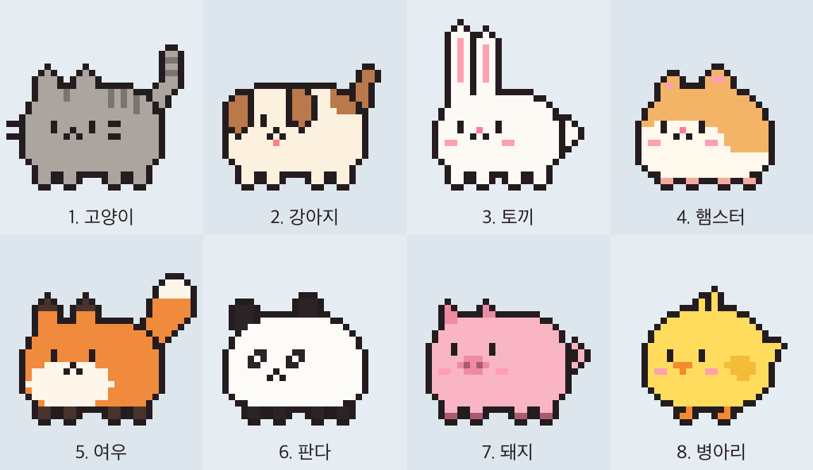

# 다마고치 (Damagochi)

화면 아래를 뛰어다니는 작은 도트 펫입니다. 펫을 클릭하면 **지금 내 Mac에서 실행 중인 AI 에이전트 세션**(Claude Code, Codex)과 **서비스별 주간 사용량이 얼마나 남았는지**를 한눈에 보여 줍니다.



- 고양이, 강아지, 토끼, 햄스터, 여우, 판다, 돼지, 병아리 중에서 고를 수 있어요.
- 에이전트가 일하는 동안에는 펫도 더 부지런히 뛰어다닙니다.
- 모든 정보는 내 Mac 안에서만 읽습니다. 앱은 인터넷으로 아무것도 보내지 않습니다.

## 설치하기

**필요한 것**: macOS 13 (Ventura) 이상. Apple Silicon과 Intel Mac 모두 지원합니다.

1. [최신 릴리스 페이지](../../releases/latest)에서 `Damagochi-x.y.z.dmg` 파일을 내려받습니다.
2. 내려받은 파일을 더블클릭해서 엽니다.
3. 열린 창에서 **Damagochi** 아이콘을 **Applications** 폴더로 끌어다 놓습니다.
4. 응용 프로그램 폴더(또는 Spotlight)에서 **Damagochi**를 실행합니다.
5. "인터넷에서 다운로드한 앱입니다. 열겠습니까?"라는 창이 뜨면 **열기**를 누릅니다.

실행하면 화면 아래에 펫이 나타나고, 메뉴 막대에도 작은 펫 아이콘이 생깁니다. Dock에는 아이콘이 나타나지 않는 것이 정상입니다.

> 이 앱은 Apple의 공증(notarization)을 받았습니다. "확인되지 않은 개발자" 경고가 뜬다면 파일이 손상됐을 수 있으니 릴리스 페이지에서 다시 내려받아 주세요.

## 사용하기

| 동작 | 결과 |
|---|---|
| 펫 클릭 | 세션·사용량 패널 열기 (다시 클릭, 바깥 클릭, `Esc`로 닫기) |
| 펫 드래그 | 집어서 다른 곳에 내려놓기 |
| 펫 우클릭 또는 메뉴 막대 아이콘 | 동물 바꾸기, 크기(64pt / 96pt), 펫 숨기기, 로그인 시 자동 실행, 종료 |

Mac을 켤 때마다 펫이 나오게 하려면 메뉴에서 **로그인 시 자동 실행**을 켜 주세요.

Dock이 화면 아래에 있으면 펫이 Dock 위로 뛰어올랐다가 내려옵니다. Dock이 옆에 있거나 숨겨져 있으면 바닥에서만 뛰어다닙니다.

## Claude Code 사용량 연동 (1분)

세션 목록과 Codex 사용량은 설치만 하면 바로 나옵니다. **Claude Code의 주간 사용량**만 한 번 설정이 필요합니다. Claude Code가 상태 표시줄(statusline)에 넘겨주는 한도 정보를 다마고치가 읽을 수 있게 연결하는 작업입니다.

`~/.claude/settings.json` 파일을 열어 아래 중 해당하는 쪽을 따라 하세요.

**상태 표시줄을 따로 쓰지 않는 경우** — 이 항목을 추가합니다.

```json
{
  "statusLine": {
    "type": "command",
    "command": "sh /Applications/Damagochi.app/Contents/Resources/claude-statusline-hook.sh"
  }
}
```

**이미 쓰는 상태 표시줄이 있는 경우** — 기존 `command` 값 **앞에** 훅을 붙입니다. 원래 표시는 그대로 유지됩니다.

```json
"command": "sh /Applications/Damagochi.app/Contents/Resources/claude-statusline-hook.sh bash ~/.claude/statusline-command.sh"
```

위 예에서 `bash ~/.claude/statusline-command.sh` 자리에 원래 쓰던 명령을 넣으면 됩니다.

저장한 뒤 Claude Code에서 메시지를 한 번 주고받으면 패널에 주간 사용량이 나타납니다. 이후로는 Claude Code가 응답할 때마다 자동으로 갱신됩니다.

> 한도 정보는 Claude 구독으로 로그인해서 쓸 때 제공됩니다. API 키로 쓰는 경우에는 표시되지 않을 수 있어요.

## 문제 해결

**펫이 안 보여요**
메뉴 막대의 펫 아이콘을 눌러 **펫 보이기**가 있는지 확인하세요. 아이콘도 없다면 앱이 꺼진 것이니 다시 실행해 주세요.

**세션이 목록에 안 나와요**
터미널에서 실행 중인 Claude Code와 Codex 세션이 표시됩니다. 방금 시작한 세션은 몇 초 뒤에 나타나며, 패널의 새로 고침 버튼으로 바로 갱신할 수 있습니다.

**Claude Code 사용량 칸에 안내 문구만 나와요**
위의 연동 설정을 했는지, 설정 후 Claude Code에서 메시지를 한 번 보냈는지 확인하세요.

**Codex 사용량이 안 나와요**
최근 Codex 사용 기록에서 한도 정보를 읽습니다. Codex를 한 번 사용하면 나타납니다.

**펫이 Dock 위치를 조금 어긋나게 알아요**
기본적으로 Dock의 폭을 어림해서 계산합니다. 메뉴의 **Dock 위치 정확히 인식 (손쉬운 사용 권한)** 을 눌러 권한을 주면 정확해집니다. 권한을 주지 않아도 사용하는 데 문제는 없습니다.

## 개인정보

다마고치는 네트워크에 접속하지 않습니다. 아래 정보를 내 Mac 안에서 읽기만 합니다.

| 읽는 것 | 용도 |
|---|---|
| `~/.claude/sessions/` | 실행 중인 Claude Code 세션 목록 |
| `~/.codex/sessions/` | 실행 중인 Codex 세션과 주간 한도 |
| 실행 중인 `codex` 프로세스 정보 | Codex 세션의 작업 폴더 |
| `~/Library/Application Support/Damagochi/claude-usage.json` | 연동 훅이 저장한 Claude Code 한도 정보 |

## 삭제하기

1. 메뉴에서 **로그인 시 자동 실행**을 켰다면 끄고, **다마고치 종료**를 누릅니다.
2. 응용 프로그램 폴더에서 **Damagochi**를 휴지통으로 옮깁니다.
3. Claude Code 연동을 했다면 `~/.claude/settings.json`의 `statusLine` 명령을 원래대로 되돌립니다.
4. 남은 데이터까지 지우려면 터미널에서 실행합니다.

```bash
rm -rf ~/Library/Application\ Support/Damagochi
defaults delete com.canine89.damagochi
```

## 직접 빌드하기

Xcode(또는 Swift 5.9 이상 툴체인)가 필요합니다.

```bash
git clone https://github.com/Canine89/damagochi.git
cd damagochi
scripts/build-app.sh --run      # build/Damagochi.app 을 만들고 실행
```

도트 그림을 고치려면 `art/animals.py`를 수정한 뒤 `python3 art/animals.py`를 실행합니다 (Pillow 필요). 배포용 서명·공증 절차는 [docs/RELEASING.md](docs/RELEASING.md)에 있습니다.

<details>
<summary>코드 구조</summary>

- `art/animals.py` — 도트 아트 생성기. 32×32 격자에 동물 8종 × 12프레임을 그려 `Resources/sprites/`에 저장
- `Sources/Damagochi/PetBrain.swift` — 이동·점프·낙하 로직 (AppKit 비의존, `--simulate`로 검증)
- `Sources/Damagochi/PetController.swift` — 투명 창과 렌더링, 마우스 입력
- `Sources/Damagochi/PanelController.swift`, `PanelView.swift` — 세션·사용량 패널
- `Sources/Damagochi/Monitor.swift`, `ProcScan.swift` — 세션·사용량 수집 (`--dump`로 확인)
- `Sources/Damagochi/WorldScanner.swift` — 화면 범위와 Dock(턱) 인식
- `Resources/claude-statusline-hook.sh` — Claude Code 연동 훅

</details>

## 라이선스

[MIT](LICENSE)
